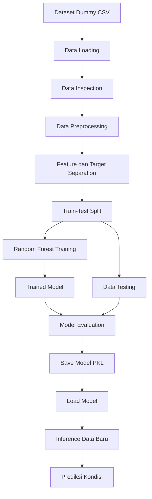
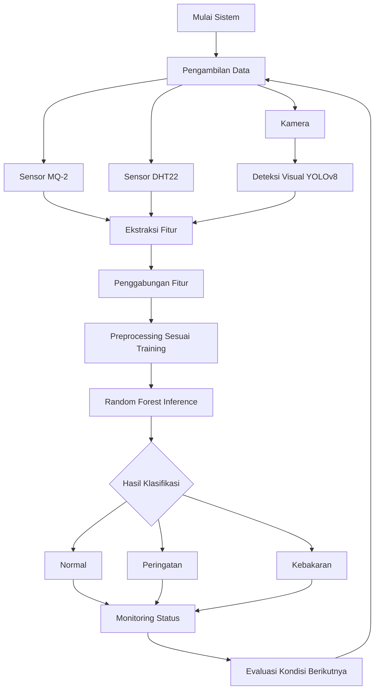

# 🔥 Sistem Deteksi Dini Kebakaran Berbasis Multimodal Sensor Fusion Menggunakan Random Forest

## 📌 Deskripsi Proyek

Proyek ini merupakan implementasi **Supervised Machine Learning untuk deteksi dini kebakaran** menggunakan pendekatan *multimodal sensor fusion*. Sistem dirancang untuk menggabungkan informasi dari beberapa sumber data, yaitu sensor gas MQ-2, sensor suhu dan kelembapan DHT22, serta hasil deteksi visual dari model YOLOv8.

Data dari berbagai sumber tersebut digunakan sebagai fitur masukan (*input features*) bagi model **Random Forest Classifier** untuk mengklasifikasikan kondisi lingkungan ke dalam tiga kategori:

- **Normal** — kondisi lingkungan berada dalam keadaan normal.
- **Peringatan** — terdapat indikasi awal yang memerlukan perhatian lebih lanjut.
- **Kebakaran** — data menunjukkan indikasi kondisi kebakaran.

Model dilatih menggunakan dataset berformat CSV, dievaluasi menggunakan data pengujian, dan disimpan dalam format `.pkl` agar dapat digunakan kembali untuk proses inferensi tanpa perlu melakukan pelatihan ulang.

> **Status pengembangan:** Proyek ini berfokus pada pengembangan dan evaluasi model Machine Learning menggunakan dataset dummy sintetis. Integrasi langsung dengan perangkat sensor fisik dan kamera secara *real-time* merupakan bagian dari rancangan sistem yang perlu diimplementasikan dan divalidasi lebih lanjut.

## 🎯 Tujuan Proyek

1. Mengimplementasikan Supervised Learning untuk klasifikasi kondisi kebakaran.
2. Menggabungkan fitur dari sensor gas, suhu, kelembapan, dan deteksi visual.
3. Menerapkan algoritma Random Forest untuk klasifikasi multikelas.
4. Melakukan preprocessing, pelatihan, pengujian, dan evaluasi model.
5. Menyimpan model terlatih ke dalam file `.pkl` agar dapat digunakan kembali.
6. Menyusun rancangan sistem deteksi dini kebakaran berbasis multimodal sensor fusion.

## 🛠️ Teknologi yang Digunakan

| Teknologi | Fungsi |
|---|---|
| Python | Bahasa pemrograman utama |
| JupyterLab | Lingkungan pengembangan dan eksperimen |
| Pandas | Membaca dan mengolah dataset |
| NumPy | Operasi numerik |
| Matplotlib | Visualisasi data dan hasil evaluasi |
| Seaborn | Visualisasi distribusi data dan confusion matrix |
| Scikit-learn | Preprocessing, training, dan evaluasi Machine Learning |
| Random Forest | Model klasifikasi utama |
| Joblib | Menyimpan dan memuat model `.pkl` |
| MQ-2 | Sumber data gas/asap untuk rancangan sistem |
| DHT22 | Sumber data suhu dan kelembapan |
| YOLOv8 | Sumber fitur deteksi api dan asap dari citra |

## 🧠 Konsep Multimodal Sensor Fusion

*Multimodal sensor fusion* merupakan pendekatan penggabungan informasi dari beberapa sumber data untuk menghasilkan keputusan yang lebih informatif dibandingkan hanya menggunakan satu sumber data.

Pada proyek ini, penggabungan dilakukan pada tingkat fitur (*feature-level fusion*). Fitur numerik dari sensor dan hasil deteksi visual ditempatkan dalam satu baris data sebelum diproses oleh model Random Forest.

### Sumber data dan fitur

| Sumber | Fitur | Keterangan |
|---|---|---|
| MQ-2 | `mq2_value` | Nilai pembacaan sensor gas |
| DHT22 | `temperature_c` | Suhu lingkungan dalam °C |
| DHT22 | `humidity_percent` | Kelembapan relatif dalam % |
| YOLOv8 | `fire_confidence` | Confidence deteksi objek api |
| YOLOv8 | `smoke_confidence` | Confidence deteksi objek asap |
| YOLOv8 | `fire_detected` | Indikator deteksi api |
| YOLOv8 | `smoke_detected` | Indikator deteksi asap |

Fitur-fitur tersebut digunakan sebagai masukan model untuk memprediksi label `Normal`, `Peringatan`, atau `Kebakaran`.

**Catatan:** Pada dataset dummy, seluruh fitur disimulasikan. Nilai `mq2_value` bukan hasil kalibrasi konsentrasi gas, sedangkan confidence YOLOv8 merupakan fitur simulasi dan bukan keluaran deteksi kamera secara langsung.

## 🔄 Pipeline Machine Learning

Pipeline Machine Learning terdiri atas empat tahap utama: *data loading*, *preprocessing*, *training*, dan *inference*.

### 1. Data Loading

Tahap ini bertujuan membaca dataset dan memahami struktur data sebelum proses pelatihan.

Dataset disimpan dalam format CSV dengan nama `dataset_dummy_deteksi_kebakaran_2000.csv`.

Contoh kode:

```python
import pandas as pd

df = pd.read_csv("dataset_dummy_deteksi_kebakaran_2000.csv")

print(df.head())
print(df.info())
print(df["label"].value_counts())
```

Tahapan yang dilakukan:

- Membaca dataset menggunakan Pandas.
- Memeriksa nama kolom dan tipe data.
- Memeriksa distribusi kelas target.
- Memeriksa nilai kosong dan data duplikat.
- Memahami karakteristik setiap fitur.

Dataset awal terdiri dari 2.000 baris dengan distribusi label:

| Label | Jumlah | Persentase |
|---|---:|---:|
| Normal | 1.000 | 50% |
| Peringatan | 600 | 30% |
| Kebakaran | 400 | 20% |
| **Total** | **2.000** | **100%** |

Data tersebut merupakan data sintetis yang dibuat untuk keperluan eksperimen dan pengujian pipeline Machine Learning.

### 2. Data Preprocessing

Preprocessing bertujuan menyiapkan data agar dapat digunakan oleh model Machine Learning.

Tahapan preprocessing meliputi:

1. **Pemeriksaan kualitas data:** memeriksa nilai kosong, data duplikat, dan tipe data.
2. **Penanganan missing values:** menggunakan imputasi apabila ditemukan nilai yang hilang.
3. **Penanganan outlier:** memeriksa nilai ekstrem dan menentukan apakah perlu dilakukan pembatasan nilai.
4. **Pemisahan fitur dan target:** memisahkan kolom masukan dari kolom `label`.
5. **Pembagian dataset:** membagi data menjadi data training sebesar 80% dan data testing sebesar 20%.
6. **Feature scaling:** melakukan standardisasi apabila diperlukan oleh pipeline yang digunakan.

Contoh pembagian dataset:

```python
from sklearn.model_selection import train_test_split

X = df.drop(columns=["label"])
y = df["label"]

X_train, X_test, y_train, y_test = train_test_split(
    X,
    y,
    test_size=0.2,
    random_state=42,
    stratify=y
)
```

Dengan 2.000 baris data, pembagian 80:20 menghasilkan 1.600 sampel training dan 400 sampel testing.

**Catatan teknis:** Random Forest tidak mewajibkan standardisasi fitur. Apabila standardisasi tetap digunakan, parameter scaler harus dipelajari hanya dari data training dan diterapkan secara konsisten pada data testing serta data inferensi.

### 3. Model Training

Algoritma yang digunakan adalah **Random Forest Classifier**, yaitu metode *ensemble learning* yang menggabungkan prediksi dari sejumlah decision tree untuk menghasilkan klasifikasi akhir.

Setiap decision tree mempelajari pola dari data training. Prediksi akhir ditentukan melalui agregasi suara dari pohon-pohon tersebut.

Konfigurasi model:

| Parameter | Nilai |
|---|---|
| Algoritma | Random Forest Classifier |
| `n_estimators` | 200 |
| `max_depth` | `None` |
| `min_samples_split` | 2 |
| `min_samples_leaf` | 1 |
| `class_weight` | `balanced` |
| `random_state` | 42 |

Contoh kode training:

```python
from sklearn.ensemble import RandomForestClassifier

rf_model = RandomForestClassifier(
    n_estimators=200,
    max_depth=None,
    min_samples_split=2,
    min_samples_leaf=1,
    class_weight="balanced",
    random_state=42,
    n_jobs=-1
)

rf_model.fit(X_train, y_train)
```

Parameter `class_weight="balanced"` digunakan untuk menyesuaikan bobot kelas berdasarkan distribusi label dalam data training.

Setelah training, model mempelajari hubungan antara fitur sensor dan visual dengan kategori kondisi lingkungan.

### 4. Model Evaluation

Model diuji menggunakan data testing yang tidak digunakan selama proses training. Evaluasi dilakukan untuk mengetahui performa klasifikasi pada data pengujian.

Metrik yang digunakan:

- **Accuracy:** proporsi seluruh prediksi yang benar.
- **Precision:** ketepatan prediksi pada setiap kelas.
- **Recall:** kemampuan model menemukan sampel yang benar-benar termasuk dalam suatu kelas.
- **F1-score:** rata-rata harmonik precision dan recall.
- **Confusion matrix:** visualisasi perbandingan label aktual dan prediksi.

Contoh kode evaluasi:

```python
from sklearn.metrics import (
    accuracy_score,
    classification_report,
    confusion_matrix
)

y_pred = rf_model.predict(X_test)

print("Accuracy:", accuracy_score(y_test, y_pred))
print(classification_report(y_test, y_pred, zero_division=0))
print(confusion_matrix(y_test, y_pred))
```

Dalam sistem deteksi kebakaran, nilai **recall untuk kelas `Kebakaran`** perlu diperhatikan karena kesalahan berupa kebakaran yang tidak terdeteksi (*false negative*) dapat menimbulkan risiko keselamatan.

Hasil evaluasi aktual dicatat berdasarkan output eksperimen di JupyterLab. Performa tinggi pada dataset sintetis tidak dapat langsung dianggap mewakili performa sistem pada kondisi kebakaran nyata.

### 5. Model Inference

Inference adalah tahap penggunaan model yang telah dilatih untuk memprediksi label dari data baru.

Contoh kode:

```python
y_pred = rf_model.predict(X_test)

print("Prediksi:", y_pred[:10])
```

Contoh satu sampel data baru:

```python
sample = X_test.iloc[[0]]

prediction = rf_model.predict(sample)

print("Hasil klasifikasi:", prediction[0])
```

Data baru harus memiliki fitur dan urutan kolom yang sesuai dengan data training. Jika model dilatih menggunakan fitur yang telah distandardisasi, data baru harus melewati scaler yang sama sebelum digunakan untuk prediksi.

### 6. Model Export dan Loading

Model yang sudah dilatih disimpan menggunakan Joblib dalam format `.pkl`.

Menyimpan model:

```python
import joblib

joblib.dump(
    rf_model,
    "random_forest_deteksi_kebakaran.pkl"
)
```

Memuat model kembali:

```python
import joblib

rf_model = joblib.load(
    "random_forest_deteksi_kebakaran.pkl"
)
```

Penyimpanan ini memungkinkan model digunakan kembali tanpa menjalankan proses training dari awal.

Apabila preprocessing menggunakan `StandardScaler`, objek scaler juga harus disimpan secara terpisah atau dimasukkan ke dalam pipeline yang disimpan bersama model. File model saja tidak otomatis menyimpan scaler yang dibuat di luar model.

## 🗺️ Draf Alur Sistem

### A. Alur pengembangan Machine Learning



Diagram ini menggambarkan alur eksperimen Machine Learning mulai dari pemuatan dataset sampai penggunaan model untuk inferensi.

### B. Rancangan alur sistem deteksi kebakaran



Pada rancangan ini, sensor MQ-2 mengukur respons terhadap gas tertentu, DHT22 menyediakan data suhu dan kelembapan, sedangkan YOLOv8 menganalisis citra untuk menghasilkan informasi deteksi api dan asap. Seluruh fitur kemudian digabungkan dan diproses oleh Random Forest untuk menghasilkan klasifikasi.

Diagram tersebut merupakan **rancangan arsitektur sistem**, bukan bukti bahwa semua perangkat telah terintegrasi dan berjalan secara real-time.

### C. Konsep keputusan sistem

| Hasil klasifikasi | Tindakan yang direncanakan |
|---|---|
| Normal | Menampilkan status lingkungan normal |
| Peringatan | Menampilkan indikasi yang perlu diperiksa |
| Kebakaran | Menampilkan peringatan kebakaran dan meneruskan informasi kepada pihak terkait |

Tindakan tersebut merupakan rancangan respons sistem. Implementasi alarm, notifikasi, atau aktivasi perangkat eksternal memerlukan pengembangan tambahan dan pengujian keselamatan.

## 📊 Interpretasi Model

Selain metrik evaluasi, model Random Forest dapat dianalisis menggunakan *feature importance* untuk mengetahui fitur yang berkontribusi terhadap pemisahan data dalam pohon keputusan.

Contoh kode:

```python
import pandas as pd

importance = pd.DataFrame({
    "Fitur": X_train.columns,
    "Importance": rf_model.feature_importances_
}).sort_values(
    "Importance",
    ascending=False
)

print(importance)
```

Hasil tersebut dapat digunakan untuk membahas fitur yang paling berpengaruh terhadap keputusan model.

Feature importance bukan bukti hubungan sebab-akibat dan dapat dipengaruhi oleh struktur dataset. Karena dataset pada proyek ini bersifat sintetis, hasil interpretasinya perlu diperlakukan sebagai hasil eksperimen, bukan kesimpulan mengenai faktor kebakaran di dunia nyata.

## 🚀 Pengembangan Selanjutnya

Beberapa pengembangan yang dapat dilakukan:

1. Mengumpulkan dataset dari sensor fisik dan kamera.
2. Mengintegrasikan YOLOv8 untuk menghasilkan fitur deteksi api dan asap secara langsung.
3. Menghubungkan sensor MQ-2 dan DHT22 ke mikrokontroler.
4. Mengembangkan pengiriman data sensor ke sistem pemrosesan.
5. Membuat dashboard monitoring untuk menampilkan status klasifikasi.
6. Menambahkan mekanisme alarm dan notifikasi.
7. Melakukan validasi model pada kondisi lingkungan yang bervariasi.
8. Mengevaluasi recall kelas kebakaran dan risiko *false negative*.

## 👨‍💻 Kontributor

**Revansyah Armadito,**
**Novia Latifatuzia**

Fokus: Supervised Learning, Random Forest Classification, Multimodal Sensor Fusion, dan deteksi dini kebakaran.
